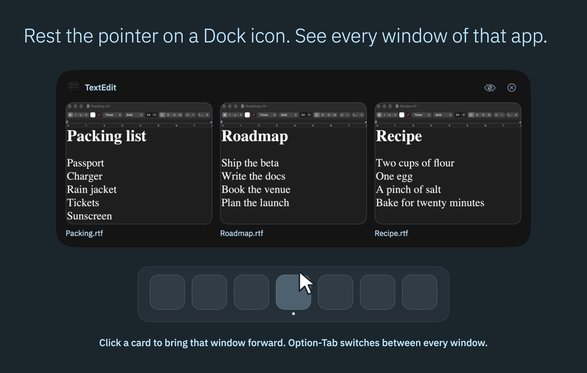

# Dockline

[](https://github.com/gabrimatic/dockline/releases/latest)
[](LICENSE)
[]()
[]()
[]()

**Rest the pointer on a Dock icon and see every window of that app, sharp, even the ones Stage Manager has parked.**

Dockline is a free menu bar app for anyone who keeps many windows open or works in Stage Manager. It adds window previews to the Dock and a window switcher on Option-Tab, in Liquid Glass.

[Website](https://gabrimatic.github.io/dockline/) · [Download](https://github.com/gabrimatic/dockline/releases/latest) · [Contributing](CONTRIBUTING.md) · [Security](SECURITY.md)

<p align="center">
  
</p>

## Install

One line. It downloads the latest release, checks its SHA-256 against `SHA256SUMS.txt`, installs to `/Applications` and opens Dockline:

```bash
curl -fsSL https://raw.githubusercontent.com/gabrimatic/dockline/main/install.sh | bash
```

To read it first: [install.sh](install.sh). Options: `--no-open`, `DOCKLINE_VERSION=1.0.0`, `DOCKLINE_INSTALL_DIR=$HOME/Applications`.

Or download `Dockline-<version>.dmg` (or the `.zip`) from [Releases](https://github.com/gabrimatic/dockline/releases/latest) and drag Dockline to Applications.

### First Open

Dockline is free and open source. Release builds are signed ad hoc, not notarized, so macOS blocks the first open of a copy you downloaded in a browser. `install.sh` does not hit this.

1. Open Dockline. macOS says it cannot verify the app. Choose **Done**.
2. Open **System Settings > Privacy & Security** and scroll to **Security**.
3. Next to the note that Dockline was blocked, click **Open Anyway** and confirm.

You do this once per download. Because the signature is ad hoc, macOS can treat a new version as a new app: if a permission stops working after an update, switch Dockline off and on in that list.

## What It Does

- **Dock previews.** Rest the pointer on a Dock icon and a glass panel shows every window of that app, with the Dock on any side.
  - Click a card to bring that window forward, from anywhere: Stage Manager's strip, the Dock's minimized area or a hidden app.
  - Point at a card for Close, Minimize and Full Screen. The header has Hide and Quit.
  - An app with no windows offers Open.
- **Sharp with Stage Manager.** Stage Manager shrinks the windows in its strip, so a picture taken on hover can only show a thumbnail. Dockline keeps a picture of each window while it is in front at full size, and shows that one. A window it has not seen in front yet shows a clean card with its app's icon and title.
- **Live cards.** A window on screen at full size stays up to date while its card is open.
- **Window switcher.** Hold Option and press Tab to move through every window, most recent first. Shift goes back, the arrow keys move, Esc cancels, and letting go of Option switches. Return or a click also switches. A quick press goes straight to the previous window.
- **Pause.** Pause Dockline from the menu bar, Settings, Control Center, Shortcuts or Siri. A Focus filter pauses it while that Focus is on.
- **Settings.** Turn previews and the switcher on or off, and set the preview size (Small, Medium or Large) and how soon previews appear (Instant, Quick or Relaxed). Launch at login starts on. You can hide the menu bar icon: open Dockline again from Finder or Spotlight to reach Settings. Settings > About has a Using Dockline section.

## Requirements

macOS 26 or later on Apple silicon. Stage Manager is optional: previews work with it on or off.

## Permissions

| Permission | Why |
| --- | --- |
| **Accessibility** | See which Dock icon the pointer is on, list an app's windows and act on them |
| **Screen Recording** | Take the pictures of your windows |

The welcome window asks for each with an **Allow…** button, and Settings > Permissions shows both states at any time. Without Accessibility, previews and the switcher stay off. Without Screen Recording, cards show the app's icon and the window's title.

## Privacy

- Dockline makes no network requests.
- Pictures stay in memory, compressed, up to 24 MB in all, and never reach the disk. The least recently used go first, and a closed window's picture goes with it.
- Keychain Access, Passwords, 1Password and Bitwarden are never captured.
- It takes no picture of the front window while the display sleeps or the screen is locked, and it stops refreshing that picture when nobody has touched the Mac for 20 seconds.
- Clicks on the Dock stay the Dock's. Dockline changes no system setting and acts on a window only when you ask it to.
- It uses one private system call, `_AXUIElementGetWindow`, loaded at runtime, to match an Accessibility window to its window number. If a future macOS removes it, cards fall back to the app's icon and Dockline keeps running.

## Limits

- A window on another Space can be shown, but Accessibility cannot reach it. Its card has no Close, Minimize or Full Screen, and a click brings its app forward without choosing that window.
- A window that has not been in front since Dockline started has no picture yet.
- The control for Control Center needs macOS 27.

## Build from Source

Requirements: Xcode 27 or later (Swift 6).

```bash
git clone https://github.com/gabrimatic/dockline.git
cd dockline
./build.sh --install
```

`scripts/package.sh` builds the release files into `dist/`. Details: [CONTRIBUTING.md](CONTRIBUTING.md).

## Uninstall

Quit Dockline, delete it from Applications, then clear its settings:

```bash
defaults delete info.gabrimatic.dockline
```

The login item goes with the app, and Dockline stores nothing else on disk. To clear what macOS keeps, select Dockline in **System Settings > Privacy & Security > Accessibility** and **Screen & System Audio Recording** and press the minus button, and remove its control from Control Center if you added it.

## Contributing

Bug reports, ideas and pull requests are welcome: [CONTRIBUTING.md](CONTRIBUTING.md). Everyone taking part follows the [Code of Conduct](CODE_OF_CONDUCT.md). Security reports go through [SECURITY.md](SECURITY.md).

## License

MIT. See [LICENSE](LICENSE).

## Trademarks

Apple, Mac, macOS, Dock, Finder, Stage Manager, Liquid Glass, Spotlight, Siri, Shortcuts, Control Center, Keychain Access, Passwords, TextEdit, Xcode and Swift are trademarks of Apple Inc., and 1Password, Bitwarden, GitHub and Buy Me a Coffee belong to their owners; Dockline is independent and is not affiliated with or endorsed by any of them.

---

Created by [Soroush Yousefpour](https://gabrimatic.info)

[](https://www.buymeacoffee.com/gabrimatic)
